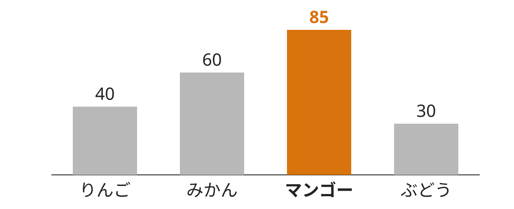

<!-- _class: title -->
<!-- _paginate: false -->

# 発表タイトル

発表者名 ／ 所属

<!--
表紙だけにロゴを置く場合:

-->

---

# このスライドで言いたいことを見出しにする

- 項目は 5 つまで、1 行で収まる長さにする
- 強調は **1〜2 箇所だけ** にする
- 収まらなければスライドを分ける

<!-- 発表者ノート: 話す内容はここに書き、スライドには書かない -->

---

# 数値は大きく、単位は小さく

利用者数

120万人

前年比

1.5倍

---

# 表は横罫線を最小限に、数値は右寄せ

| 地域 | 利用者数（人） | 前年比 |
|------|-------------:|------:|
| 東京 | **12,400** | 1.5 |
| 大阪 | 8,100 | 1.2 |
| 福岡 | 3,900 | 1.1 |

---

<!-- _class: figure -->

<!-- 図を大きく見せたいスライドはタイトルを省く -->

---

<!-- _class: summary -->
<!-- _paginate: false -->

# まとめ

- 結論 1
- 結論 2
- 結論 3
